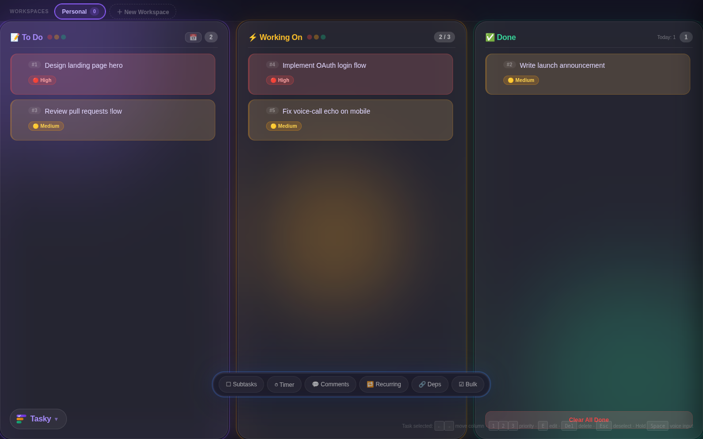
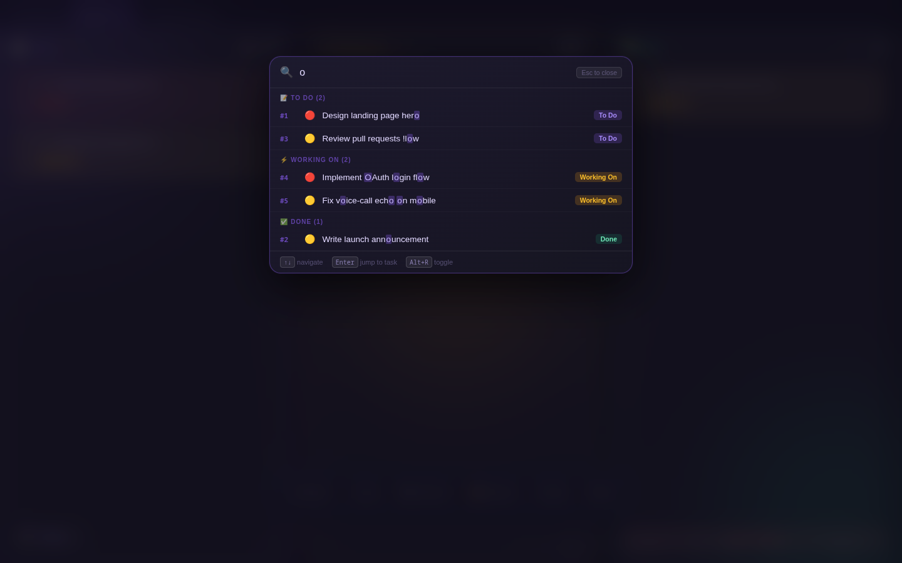
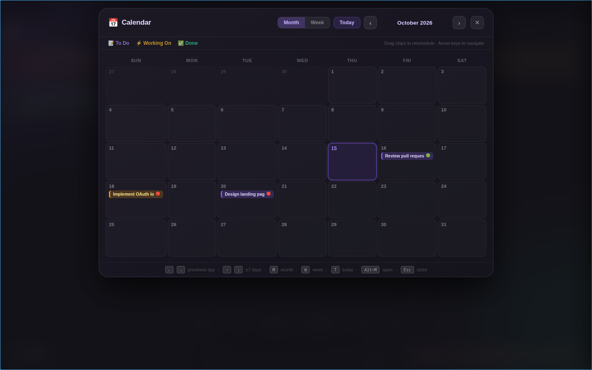
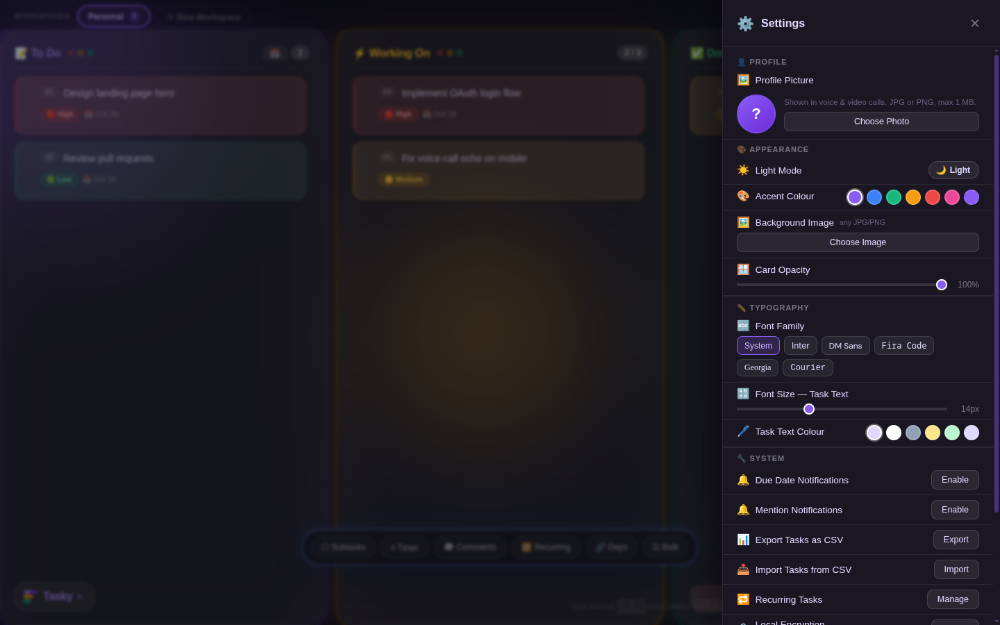
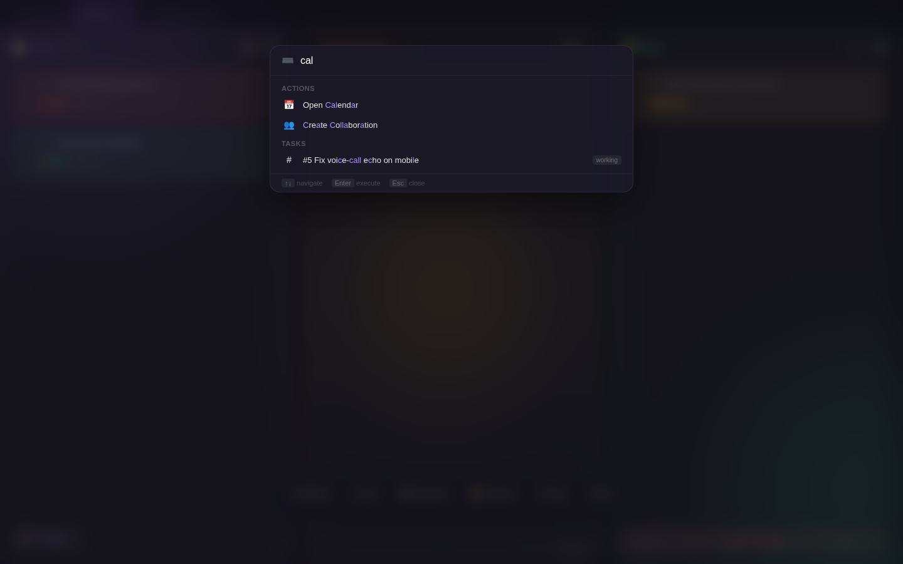

# Tasky

The all-in-one team workspace — tasks, voice/video calls, team chat,
calendar, whiteboard, and more. Zero build step — open `index.html` and go.
No servers, no npm, no subscriptions.

<p align="center">
  
</p>

## Screenshots

| Board | Global search (`Alt+R`) |
|---|---|
|  |  |

| Calendar | Settings |
|---|---|
|  |  |

<p align="center">
  
</p>

## Features

### Core — keyboard-first task board
- **Three columns** — To Do / Working On / Done
- **Keyboard-first** — any letter/number opens the input; full shortcut table below
- **Drag & drop** — reorder and move tasks between columns (mouse + touch)
- **Priority system** — High / Medium / Low with per-column filters
- **Due dates** — pick a date; overdue tasks highlighted red
- **Undo** — 3-second undo toast on delete and move
- **Workspaces** — multiple independent boards, each with its own tasks, counter, and optional collaboration link. Switch via the top pill bar.
- **Subtasks** — one-level checklist per task with `☐` toggle on each card
- **Task timers** — stopwatch and Pomodoro (25m work / 5m break) modes with auto-transition and notifications
- **Command palette** (`Ctrl+K` / `Cmd+K`) — fuzzy-search all tasks and actions; arrow-key navigable

### Collaboration
- **Task Groups** — create reusable templates; type the group name to expand onto the board
- **Team Collaboration** — supervisor creates a group; members join with a 6-character code; assign tasks, comment feed, live activity
- **Message board** — team chat with reply threads and file attachments (up to 10 MB)
- **Read-only share board** — share a live read-only board via `?view=CODE` link; visitors can leave feedback comments with no account
- **Whiteboard** — shared canvas with pen/rect/circle/line/eraser tools; Firestore-synced with live user cursors

### Voice & Video Calls
- **Voice calls** — WebRTC mesh via Firestore signaling; mute/deafen; voice activity detection; supervisor kick; minimize bar; call recording
- **Video calls** — camera toggle, screen sharing, grid/speaker layout, recording to Firebase Storage, Picture-in-Picture, bandwidth management (HD/SD), audio-only fallback
- **Smart NAT traversal** — calls start in pure peer-to-peer mode (STUN only, zero relay cost); if no peer connects within 8 seconds, both sides automatically coordinate a switch to TURN relay (needed for mobile data, CGNAT, symmetric NAT, and strict firewalls). Toggle in **Settings → Mobile / Reliable Calls** to force TURN from the start.
- **Non-trickle ICE** — all candidates are embedded in the SDP offer/answer, eliminating the candidate/SDP race condition that previously caused cross-network audio failures.

### Calendar
- **Monthly / Weekly** views with keyboard navigation
- **Drag to reschedule** — drag a task chip to a new date
- **Color-coded** by status (purple / amber / green)
- **Team avatars** on collab task chips

### Search & Dependencies
- **Global search** (`Alt+R`) — type to filter all tasks; results grouped by status; arrow-key navigable; Enter to jump
- **Task dependencies** — mark a task as "Blocked by" another; dependency graph in search panel; visual link indicators on cards
- **Rich-text Markdown** renderer for comments and descriptions

### Extended
- **Recurring tasks** — daily / weekly / monthly; auto-duplicate on completion; manager UI in Settings
- **Bulk actions** — multi-select mode via `☑ Bulk` toggle; floating action bar for move/delete/priority on multiple tasks
- **Activity feed** — `📋 Activity` panel with per-task timeline; Firestore-synced for collab; filterable by event type
- **CSV import / export** — import from CSV via Settings; export all tasks with status, priority, dates
- **@Mentions** — mention team members in comments with autocomplete and Firestore push notification
- **Supervisor locks** — restrict task assignment and deletion to the group supervisor
- **Tab-cycle workspaces** — press Tab to cycle through open workspaces
- **Due date notifications** — browser push notifications for upcoming dates

### Appearance
- **Dark / Light mode** — auto-detects system preference via `prefers-color-scheme` on first visit; toggle in Settings saves manual choice; live-switches when OS theme changes (if no explicit override)
- **Custom background** — upload any image; animated orbs float on top
- **Column glass opacity** — slider (40–100%) adjusts frosted-glass transparency
- **6 accent colours + custom picker** — purple, blue, green, amber, red, pink, or any hex
- **Typography** — 6 font families (System, Inter, DM Sans, Fira Code, Georgia, Courier); font size 11–20px; custom task text colour

---

## Security

Tasky is local-first and has been through two rounds of adversarial testing
(automated hostile agents firing live XSS payloads through every render path).
What that produced:

- **Output encoding everywhere** — every value rendered into HTML (task
  text/numbers/ids/priorities/dates, handles, group names, comments, search
  results, attachment names, timer/activity labels) is HTML-escaped at its
  sink. The Markdown renderer escapes *before* formatting and only linkifies
  `https?://` URLs, so `javascript:` / `data:` links never form.
- **Allowlists, not blocklists** — avatar images accept raster `data:` URLs
  only (no SVG/XML); attachments accept a fixed MIME list; invite codes,
  priorities, columns, timer types and recurring rules are enum-checked;
  Firestore document IDs that reach the DOM are escaped and looked up with
  throw-safe DOM methods.
- **CSV export neutralizes spreadsheet formulas** — cells starting with
  `= + - @` are `'`-prefixed so exports can't become DDE/command chains in
  Excel.
- **Content-Security-Policy** — a meta CSP blocks plugins, foreign frames
  and non-allowlisted script hosts. Note: the app genuinely needs inline
  scripts/styles, so `unsafe-inline` remains and the CSP is a backstop, not
  the primary defense — the escaping above is.
- **Firestore rules** (`firestore.rules.txt`, deploy via Firebase Console):
  visitor comments and notifications enforce field allowlists, types, sizes
  and ranges; notification `fromHandle` is pinned to the sender's own user
  document; public reads exist *only* where the product requires them
  (group/task snapshots and visitor comments for `?view=` boards).
- **Local-first privacy** — tasks live in `localStorage`; nothing leaves the
  device unless you sign in with Google for Firestore sync. Optional
  **AES-256-GCM + PBKDF2 (100k iterations, SHA-256)** encryption at rest,
  toggled in Settings. No backdoor — lose the passphrase, lose the data.
- **PWA** — installable as a standalone app; service worker is
  **network-first for code** (updates propagate; cache version is bumped on
  security fixes) and cache-first for images; offline support.

---

## File Structure

```
tasky/
├── index.html              — App shell, inline boot logic, Firebase CDN, PWA meta, onboarding
├── manifest.json           — PWA manifest (standalone display, SVG icons)
├── sw.js                   — Service worker (network-first for code, cache-first for images)
├── firestore.rules.txt     — Firestore security rules (deploy via Firebase Console)
├── tasky.css               — All styles, animations, themes, responsive layout
├── tasky.js                — Core: state, rendering, keyboard, drag & drop, Firebase, encryption, CSV
├── tasky-subtask.js        — Subtasks: one-level checklist per task
├── tasky-timer.js          — Task timers: stopwatch and Pomodoro modes
├── tasky-timer.css         — Timer UI styles
├── tasky-bulk.js           — Bulk actions: multi-select, batch move/delete/priority
├── tasky-activity.js       — Activity feed: per-task timeline, filterable
├── tasky-palette.js        — Command palette: Ctrl+K fuzzy-search tasks + actions
├── tasky-whiteboard.js     — Whiteboard: shared canvas with drawing tools
├── tasky-whiteboard.css    — Whiteboard panel styles
├── tasky-collab.js         — Collaboration: groups, supervisor, task assignment, message board
├── tasky-features.js       — Extended: recurring tasks, CSV import, @mentions, supervisor locks
├── tasky-calendar.js       — Calendar: monthly/weekly views, drag-to-reschedule, keyboard nav
├── tasky-calendar.css      — Calendar panel styles
├── tasky-voice.js          — WebRTC mesh voice calls via Firestore signaling (P2P + auto TURN fallback)
├── tasky-voice.css         — Voice call UI styles (dark + light mode)
├── tasky-video.js          — Video calls: camera, screen share, recording, PiP, grid/speaker view
├── tasky-video.css         — Video call UI styles (dark + light mode)
├── tasky-deps-search.js    — Global search (Alt+R), task dependencies, Markdown renderer
├── tasky-photos.js         — Photo attach / edit flow for the message board
├── ice-test.html           — Standalone WebRTC / STUN diagnostics page (open in any browser)
├── screenshots/            — Screenshots used in this README
├── ARCHITECTURE.md
├── README.md
└── LICENSE
```

---

## Architecture & Loading Order

Zero build step, vanilla JS only. Files load via `<script defer>` in a strict order because they share globals and extend each other through hooks (`_cardModifiers`) and `window.*` exports. See [`ARCHITECTURE.md`](./ARCHITECTURE.md) for details.

1. **`index.html`** — HTML shell + inline `<style>` for onboarding
2. **`tasky.js`** — core engine; defines `renderAllColumns`, `createTaskCard`, keyboard, drag-drop, Firebase CRUD
3. **`tasky.css`** — all stylesheets
4. **`tasky-voice.css`** / **`tasky-video.css`** / **`tasky-calendar.css`** / **`tasky-timer.css`** / **`tasky-whiteboard.css`**
5. **`tasky-voice.js`** — WebRTC voice layer; attaches to `window.*` globals
6. **`tasky-video.js`** — extends voice layer with video; wraps `vcJoin`/`vcLeave`
7. **`tasky-calendar.js`** — replaces the `_renderCalendar` stub left in features.js
8. **`tasky-subtask.js`** / **`tasky-timer.js`** / **`tasky-bulk.js`** — subtasks, timers, bulk actions (register `_cardModifiers`)
9. **`tasky-activity.js`** — activity feed panel
10. **`tasky-whiteboard.js`** — shared canvas whiteboard
11. **`tasky-deps-search.js`** — global search overlay, task dependencies
12. **`tasky-features.js`** — recurring tasks, CSV import, @mentions, supervisor locks
13. **`tasky-collab.js`** — group/team logic, supervisor panel, message board (registers `_cardModifier` for assignment badges)
14. **`tasky-palette.js`** — command palette (`Ctrl+K`); loads last so all functions are available

Inline `<script>` blocks (after deferred scripts) handle onboarding, PWA registration, and the custom confirm dialog.

---

## How to Run

```bash
python3 -m http.server 8080
```

Open **http://localhost:8080** in a browser. Chrome, Edge, or Brave recommended for voice/video calls.

You can also open `index.html` directly via `file://` — all features except cloud sync and service worker registration will work.

> **Note**: If you've loaded the app before, the service worker may serve cached content. The service worker uses network-first for `.js`/`.css`/`.html` files so updates are picked up on the next load, but to be sure open DevTools → Application → Service Workers → **Unregister**, then refresh.

### Voice/Video Calls Across Networks

Calls default to **pure peer-to-peer** (STUN only) — fastest, no relay cost, works on WiFi and broadband across different networks. If no peer reaches a connected state within 8 seconds (typical for mobile data / CGNAT / symmetric NAT), both peers automatically coordinate a switch to TURN relay.

The default TURN servers are free public services (OpenRelay) which are often rate-limited or unreachable from mobile networks. For production deployments, provision your own [coturn](https://github.com/coturn/coturn) server and override before `tasky-voice.js` loads:

```html
<script>
  window.VC_ICE_SERVERS = [
    { urls: 'stun:stun.yourdomain.com:3478' },
    { urls: 'turn:turn.yourdomain.com:3478',
      username: '<generated>',
      credential: '<generated>' },
    { urls: 'turn:turn.yourdomain.com:3478?transport=tcp',
      username: '<generated>',
      credential: '<generated>' }
  ];
</script>
<script defer src="tasky-voice.js"></script>
```

To force TURN from the start (skip the 8-second P2P attempt), toggle **Settings → Mobile / Reliable Calls** to ON. To disable the auto-switch entirely:

```html
<script>window.VC_DISABLE_AUTO_TURN = true;</script>
```

A standalone diagnostic page is included — open `ice-test.html` in any browser on each network you want to test calls between. It runs the same ICE gathering Tasky uses and prints how many `host` / `srflx` / `relay` candidates were gathered, so you can verify whether STUN/TURN is reachable before starting a real call.

---

## Technology Stack

| Technology | Used for |
|---|---|
| Firebase 10.12.0 compat SDK | Firestore, Auth, Storage |
| WebRTC (mesh topology) | Peer-to-peer voice/video calls via Firestore signaling |
| Web Audio API (`AudioContext`, `AnalyserNode`) | Voice activity detection |
| MediaRecorder API | Call recording → Firebase Storage |
| Screen Capture API (`getDisplayMedia`) | Screen sharing |
| Picture-in-Picture API | Floating video overlay |
| Service Worker API | Offline cache, PWA installability |
| `prefers-color-scheme` Media Query | Auto-detect OS dark/light mode |
| Web Speech API | Voice dictation input |
| AES-256-GCM + PBKDF2 | Local encryption at rest |
| Canvas API (`<canvas>`) | Whiteboard drawing tools |

---

## Keyboard Shortcuts

| Key | Context | Action |
|---|---|---|
| Any letter/number | Board | Open floating input |
| `Enter` | Input | Save task |
| `Esc` | Input | Cancel & close input |
| `Esc` | Selected task | Deselect task |
| `Esc` | Search overlay | Close search |
| `←` / `→` | Selected task | Move to previous / next column |
| `1`–`3` | Selected task | Set priority High / Medium / Low |
| `Delete` / `Backspace` | Selected task | Delete with undo |
| `Alt`+`1`–`9` | Board | Select task by number |
| `Alt`+`G` | Board | Enter goto mode — type number + Enter |
| `Alt`+`R` | Anywhere | Open global search |
| `Alt`+`M` | Anywhere | Open calendar |
| `Ctrl+K` / `Cmd+K` | Anywhere | Open command palette |
| `Tab` | Board | Cycle to next workspace |
| Hold `Space` | Board | Voice dictation |
| `↑` / `↓` | Search / TG suggestions | Navigate results |
| `Enter` | Search / TG suggestions | Jump to task / expand group |
| `M` | Calendar | Month view |
| `W` | Calendar | Week view |
| `T` | Calendar | Go to today |

---

## Browser Support

| Browser | Tasks | Voice Input | Voice Calls | Video Calls | Cloud Sync | Collaboration |
|---|---|---|---|---|---|---|
| Chrome 90+ | ✅ | ✅ | ✅ | ✅ | ✅ | ✅ |
| Edge 90+ | ✅ | ✅ | ✅ | ✅ | ✅ | ✅ |
| Brave | ✅ | ✅ | ✅ | ✅ | ✅ | ✅ |
| Firefox | ✅ | ❌ | ❌ | ❌ | ✅ | ✅ |
| Safari | ✅ | ⚠️ partial | ❌ | ❌ | ✅ | ✅ |

> **Mobile data calls**: pure P2P works on most home/office WiFi across networks. Mobile carriers (CGNAT) and strict corporate firewalls require TURN relay — Tasky auto-switches after 8s, or you can force TURN in Settings.

---

## Data & Privacy

All data is stored in `localStorage` and optionally synced to Firebase Firestore when signed in. Nothing is sent to any other server.

**Encryption**: When enabled, all workspace data is encrypted at rest with AES-256-GCM using a key derived from your passphrase via PBKDF2 (100k iterations, SHA-256). Preferences (theme, opacity, font, accent) remain plaintext. No backdoor — if you forget the passphrase, data cannot be recovered.

Clearing site data will erase your tasks — export to CSV first if you need a backup.

---

## Customisation

CSS custom properties at the top of `tasky.css`:

```css
:root {
    --todo-color:    #8B5CF6;   /* purple */
    --working-color: #F59E0B;   /* amber  */
    --done-color:    #10B981;   /* green  */
}
```

Change these to retheme column rings, orbs, and accents in one go. Most visual settings are also adjustable from the **Settings** panel.

---

## License

Source Available Non-Commercial — see [LICENSE](./LICENSE).

You may view, fork, and run this software for personal/educational use.
Selling, monetizing, or hosting it as a paid service is strictly
prohibited without written permission.

For commercial licensing: touhidsiddiqueeraj@gmail.com
